# Top-level optimization of SCI CGO-CNN-BiGRU-Attention Chaotic Game Optimization for Convolutional Neural Networks and Gated Recurrent Units Fusion with Attention Mechanism for Multivariate Regression Prediction

Applicable Platform: Matlab 2023 version and above.
CGO Chaos Game Optimization Algorithm, published in the top-tier journal of SCI and Chinese Academy of Sciences, "Artificial Intelligence Review".
This algorithm was proposed very recently and has not yet been applied to high-level literature.
Similarly, we utilized this innovative algorithm with clear physical meanings to optimize hyperparameters in our CNN-BiGRU-Attention time-series and spatial feature combination - attention mechanism regression prediction program code, forming the CGO-CNN-BiGRU-Attention multivariate regression prediction model.
Document Interpretation: This paper proposes a new metaheuristic algorithm called Chaos Game Optimization (CGO), which is used to solve optimization problems. The main concept of the CGO algorithm is based on some principles of chaos theory, where the concept of chaos game refers to the configuration and self-similarity of fractals. By using various benchmark problems to evaluate the performance of the CGO algorithm and comparing it with other random optimization algorithms. The results show that the CGO outperforms other optimizers in terms of convergence and statistical data.
Principle: In mathematics, fractals are subsets of Euclidean space, where specific geometric patterns repeat at multiple scales. Fractals have roughly similar shapes at different scales and are represented as self-similar systems. A famous fractal is the Mandelbrot set, which represents a carefully designed unbounded domain where multiple recursive details gradually emerge at different scales.
Fractal self-similarity, in simple terms, means that no matter how you magnify a shape, you can find similar shapes at a more complex level, and fractals are everywhere in life, from the Milky Way to seashells.
The article introduces the process of gradually creating the Sherbinisky triangle using the chaos game method. These decision variables represent the positions of these seeds that meet the conditions within the Sherbinisky triangle. The Sherbinisky triangle is considered a search space for candidate solutions in optimization algorithms. For each initial qualified seed in the search space, a temporary triangle is created to create some new seeds within the search space, which can be regarded as new qualified seeds for completing the overall shape of the Sherbinisky triangle.
The innovative aspects of the CGO-CNN-BiGRU-Attention multivariate regression prediction model are as follows:
CGO algorithm's innovation compared to traditional intelligent algorithms:
① Parametric-free framework: The CGO algorithm is an unparameterized metaheuristic method that does not require any internal parameters to be defined throughout the optimization process. In other words, it reduces the error caused by human-defined parameters.
② Clarity of physical concepts: The introduction of chaotic theory and consideration of the qualified configurations of fractals and self-similarity issues in the search space have made global and local searches more sensitively satisfied. This approach based on physics makes the CGO algorithm better interpretable in global optimization problems.
③ Superiority over other optimization algorithms: Through comparative experiments with other random optimization algorithms, the CGO algorithm shows excellent convergence and statistical data performance. Experimental results indicate that the CGO algorithm outperforms other comparative algorithms on multiple benchmark problems. This suggests that the CGO algorithm has higher effectiveness and performance in solving optimization problems.
Optimized Algorithm for Predicting Future Steps in Multivariate Time Series: KOA-CNN-BiGRU-Attention

1. Functionality:
1. Multivariate feature input with a single sequence variable output, where the features from the previous day are used to predict the next day's data, achieving predictions 24 steps ahead.
2. Optimize learning rates, convolution kernel sizes, and number of neurons through the CGO optimization algorithm, aiming for the minimum MAPE as the objective function.
3. Provide loss and RMSE iterative change polar coordinates graphs; network feature visualization graphs; test comparison graphs; fitness curve (if the initial accuracy is highest, then the fitness curve will be a horizontal line).
4. Provide MAPE, RMSE, MAE, and other calculation results display.

Applicable fields: Wind speed prediction, photovoltaic power prediction, power generation power prediction, carbon price prediction, and other applications.

Dataset format:
The dataset consists of 18 meteorological features from the previous day, sampled at 24-hour intervals, with the output being the power output for the next day's 24 hours, i.e., 18×24 input, 1×24 output, totaling 75 such samples.
Prediction vs. actual values; training feature visualization:
Training error curve in polar form (error gradually approaching zero from inside to outside); fitness curve (error gradually decreasing)
Error assessment:

## Images

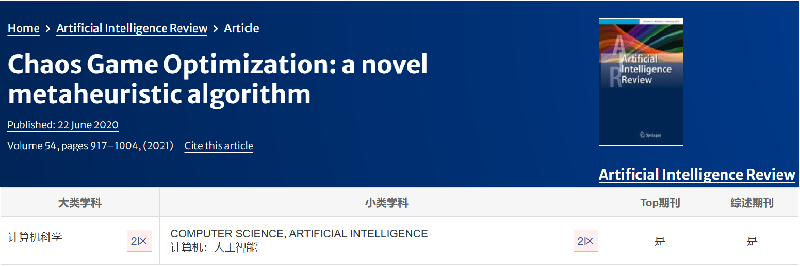
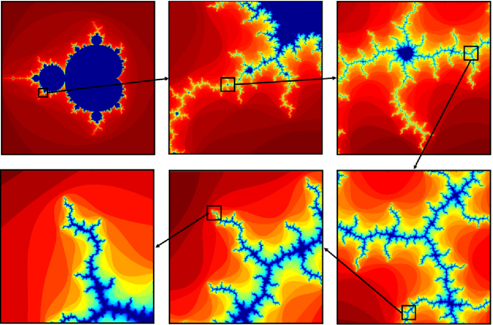
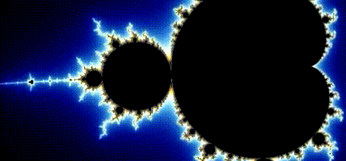

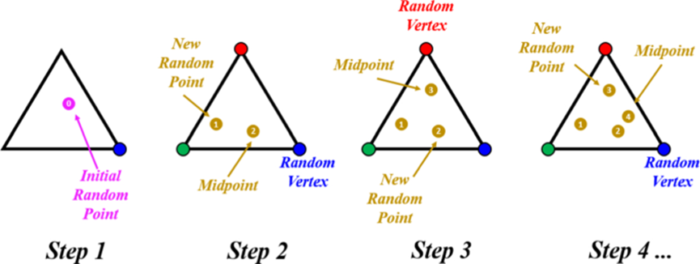
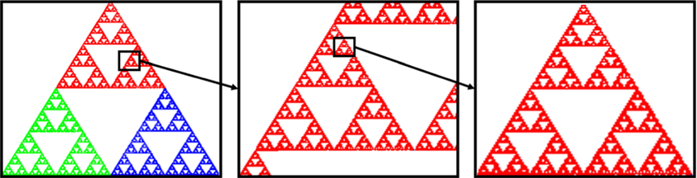
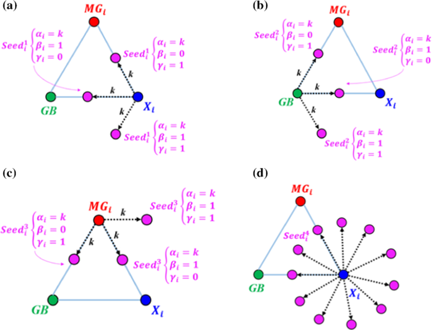
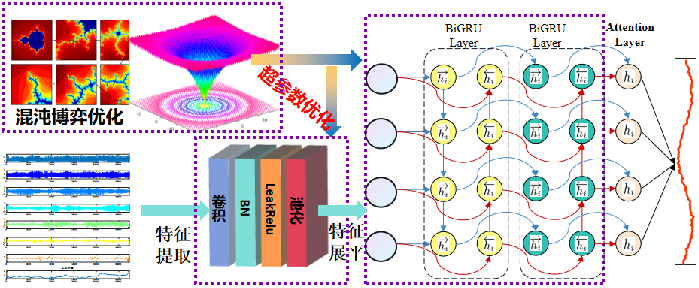

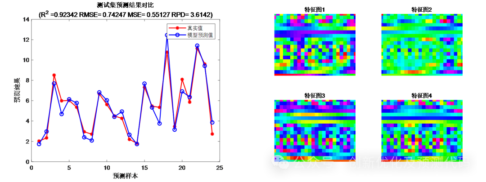
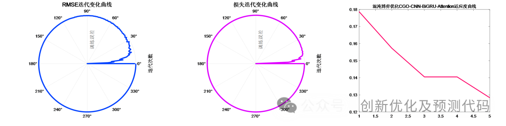
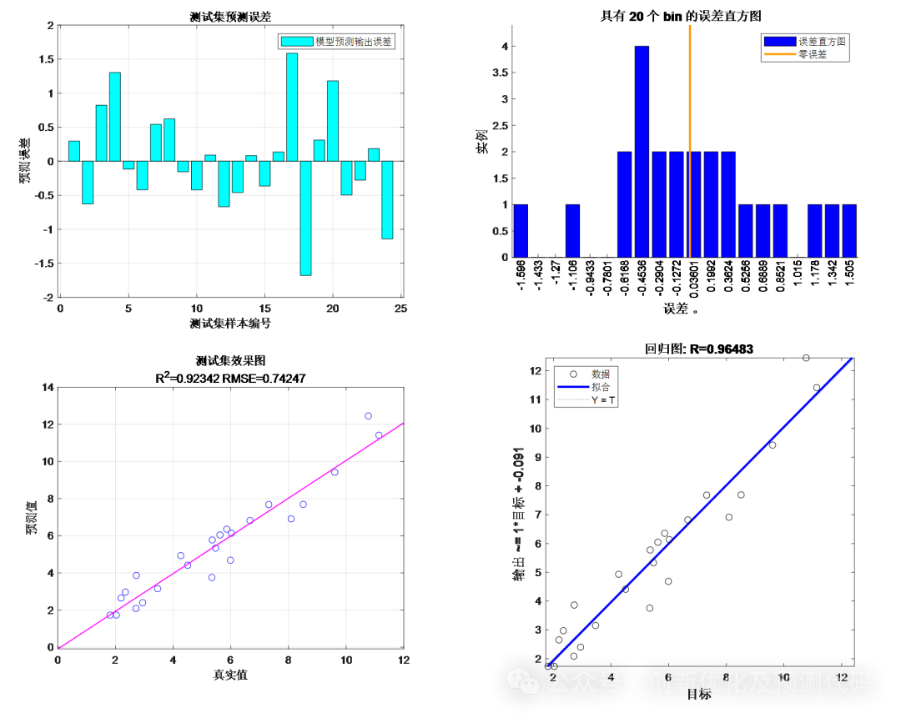
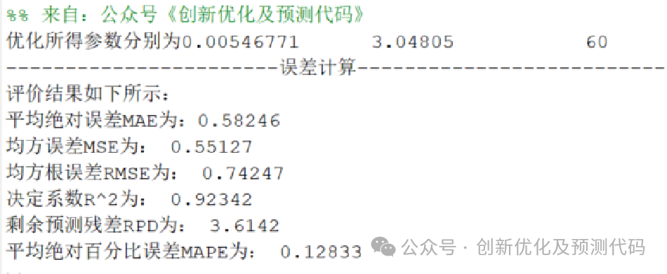

<!-- PAYMENT_BLOCK -->

## Get this dataset

- Payment link (Stripe): [Buy now](https://buy.stripe.com/3cs8yP7sY87d0vu9AB)
- Payment QR code: 

<!-- /PAYMENT_BLOCK -->
